<div align="center">


# Finora

### Personal Finance & Expense Analytics

**Take Control of Your Money.**

Track income and expenses, set budgets that warn you before you overspend, and see exactly where your money goes. Interactive charts and printable reports are built from your own data.

<p>
  
  
  
  
  
</p>
<p>
  
  
  
  
</p>

[Features](#-features) ·
[Screenshots](#-screenshots) ·
[Installation](#-installation) ·
[Testing](#-testing) ·
[Author](#-author)

<br>

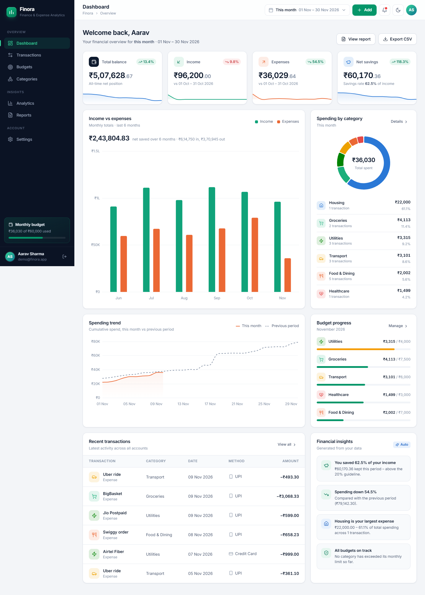

</div>

---

## 📑 Table of Contents

- [Overview](#-overview)
- [Features](#-features)
- [Tech Stack](#-tech-stack)
- [Architecture](#-architecture)
- [Database Schema](#-database-schema)
- [Routes](#-routes)
- [Project Structure](#-project-structure)
- [Installation](#-installation)
  - [Windows (PowerShell)](#windows-powershell)
  - [Linux / macOS](#linux--macos)
- [Configuration](#-configuration)
- [Database Setup & Demo Data](#-database-setup--demo-data)
- [Running the App](#️-running-the-app)
- [Testing](#-testing)
- [Screenshots](#-screenshots)
- [Security](#-security)
- [Future Scope](#-future-scope)
- [Author](#-author)

---

## 🌟 Overview

**Finora** is a full-stack personal finance web application built with Flask and SQLite. Each user gets a private ledger of income and expenses, organised into custom categories and tracked against monthly budgets.

The data feeds a dashboard, five Chart.js analytics charts, plain-language financial insights, budget alerts, and a printable financial statement with CSV export.

| Highlight | Details |
|---|---|
| 💰 **Precise money handling** | Amounts are stored as integer paise and handled as Python `Decimal`, never as floats |
| 🇮🇳 **INR-first formatting** | Indian digit grouping (e.g. `₹1,24,560.00`) and compact chart labels (`₹1.5L`, `₹2.5Cr`) |
| 🔒 **Private by design** | Every query is scoped to the signed-in user; other users' records return 404 |
| 🌗 **Light / Dark / System themes** | Charts re-theme with the UI |
| 📱 **Responsive** | Verified at 1440, 1366, 768 and 375 px widths |

---

## ✨ Features

### 🔐 Authentication & Accounts
- Registration with server-side validation (name, email format, unique email, password ≥ 8 characters, matching confirmation)
- Login with an optional *Keep me signed in*, plus logout (POST only)
- New accounts get **13 default categories** (4 income, 9 expense)
- Account deletion (password confirmation required) permanently removes every transaction, budget and category

### 📊 Dashboard
- **Four KPI cards:** Total Balance (all-time), Income, Expenses and Net Savings. Each shows a sparkline and the % change against the previous equivalent period
- **Global date range selector:** This month, Last month, Last 3 months, Last 6 months, This year, Last 12 months
- **Income vs Expenses** bar chart (6 or 12 months, depending on the range)
- **Spending by Category** doughnut with a ranked category list; anything past the top 5 is folded into *Other*
- **Spending Trend:** cumulative spend for the current period vs the previous period
- **Budget Progress** for the five category budgets with the highest usage
- **Recent Transactions** (latest 6)
- **Financial Insights** generated from your data: savings rate, spending change, largest category, sharp category increases, budget status and average daily spend
- **Empty state** with one-click **Load sample data** (12 months of transactions + budgets) for new accounts

### 💳 Transactions
- Add, edit and delete income or expenses through a modal form, with a confirmation dialog before deleting
- Fields: title, type, amount, date, category, payment method, notes
- Payment methods: UPI, Debit Card, Credit Card, Net Banking, Cash, Wallet, Bank Transfer
- The category dropdown only shows categories matching the selected type
- **Search** (title and notes), **filters** (type, category, payment method, from/to date) and removable filter chips
- **Sorting** by date or amount, ascending or descending
- **Pagination** (12 per page)
- Income / Expense / Net totals for the current filter
- **CSV export** of the filtered list

### 🎯 Budgets
- An **overall monthly budget** plus one budget per **expense category**. Budgets repeat every month
- Configurable **alert threshold** (50–100%), with *On track*, *Near limit* and *Over budget* states
- Summary tiles: total budget, total spent, remaining, alert count
- **Month navigation** to review past months against the same limits
- Sort by most used, name or amount
- Only one budget per category is allowed (enforced in the UI and on the server)

### 🏷️ Categories
- Custom income and expense categories with a **38-icon picker**, a **9-colour palette** and a live preview
- Per-category transaction count and spend this month
- Case-insensitive duplicate protection
- Deleting a category keeps its transactions (they become *Uncategorised*) and removes its budget

### 📈 Analytics
A switchable **3 / 6 / 12-month** view with five Chart.js visualisations, all built from database data:

| Chart | Type |
|---|---|
| Income vs Expenses | Grouped bar |
| Expenses by Category | Doughnut |
| Spending Trend (with 3-month moving average) | Line |
| Monthly Savings (with savings rate in the tooltip) | Bar |
| Budget vs Actual (current month) | Horizontal bar |

Also shown: summary KPIs (total income, expenses, net savings, average savings rate) and an income-sources breakdown. The same figures are exposed as JSON at `/analytics/data`.

### 🧾 Reports
- Presets (This month, Last month, Last 3 months, Year to date, Last 12 months) or a **custom date range**
- Summary: total income, total expenses, net savings with savings rate, average daily spend
- Expense breakdown by category with proportional bars, income by source, and the 5 largest expenses
- **Monthly summary table** with totals (multi-month ranges)
- **CSV export** and **Print / PDF** via a dedicated print stylesheet

### 🔔 Notifications
- Budgets that crossed their alert threshold or are over limit
- Unusually large expenses in the last 7 days (≥ 3× the 90-day median expense)

### ⚙️ Settings
- **Profile:** name and email
- **Preferences:** display currency (INR, USD, EUR, GBP; symbol and number grouping only, no conversion) and theme (Light / Dark / System)
- **Security:** change password, sign out
- **Data & account:** record counts, full CSV export, delete account

---

## 🛠 Tech Stack

| Layer | Technology |
|---|---|
| **Backend** | Python, Flask 3 (application factory + blueprints) |
| **Database** | SQLite via Flask-SQLAlchemy (SQLAlchemy 2) |
| **Auth** | Flask-Login, Werkzeug password hashing |
| **Security** | Flask-WTF `CSRFProtect` |
| **Templating** | Jinja2 |
| **Frontend** | HTML5, CSS3 (custom design system with CSS variables, Grid & Flexbox), vanilla JavaScript |
| **Charts** | Chart.js 4.4.1 (CDN) |
| **Icons / Font** | Lucide 0.460.0 (CDN), Inter (Google Fonts) |
| **Config** | python-dotenv |
| **Testing** | pytest; Playwright (optional browser QA scripts) |

> **Note:** Chart.js, Lucide icons and the Inter font load from CDNs, so the browser needs internet access for the full UI.

---

## 🏗 Architecture

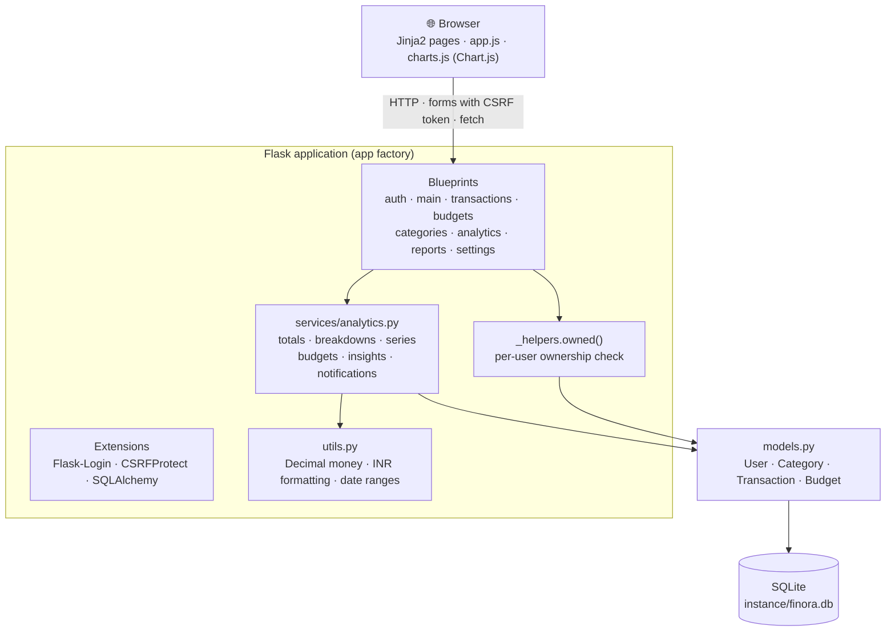

**Request flow:** a blueprint route validates input → loads only the current user's rows (`owned()` / `user_id` filters) → calls the analytics service for aggregates → renders a Jinja2 template. Chart data is embedded as JSON and drawn by `charts.js`, which reads colours from CSS variables so charts follow the active theme.

---

## 🗄 Database Schema

Tables are created automatically on startup (`db.create_all()`). Monetary columns hold **integer minor units** (paise).

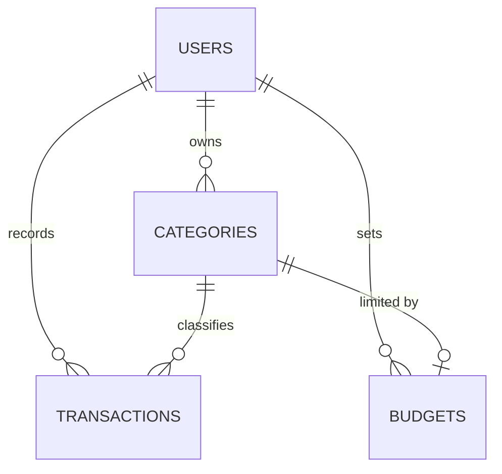

<details open>
<summary><b><code>users</code></b></summary>

| Column | Type | Notes |
|---|---|---|
| `id` | Integer | Primary key |
| `name` | String(80) | Required |
| `email` | String(120) | Unique, indexed |
| `password_hash` | String(255) | Werkzeug hash |
| `currency` | String(3) | Default `INR` |
| `theme` | String(10) | `light` / `dark` / `system` |
| `created_at` | DateTime | UTC |

</details>

<details open>
<summary><b><code>categories</code></b></summary>

| Column | Type | Notes |
|---|---|---|
| `id` | Integer | Primary key |
| `user_id` | Integer | FK → `users.id`, indexed |
| `name` | String(40) | Unique per user + kind |
| `kind` | String(7) | `income` / `expense` |
| `icon` | String(40) | Lucide icon name |
| `color` | String(7) | Hex colour |
| `created_at` | DateTime | UTC |

</details>

<details open>
<summary><b><code>transactions</code></b></summary>

| Column | Type | Notes |
|---|---|---|
| `id` | Integer | Primary key |
| `user_id` | Integer | FK → `users.id`, indexed |
| `category_id` | Integer | FK → `categories.id`, nullable (uncategorised) |
| `title` | String(80) | Required |
| `kind` | String(7) | `income` / `expense` |
| `amount_minor` | BigInteger | Amount in paise |
| `date` | Date | Indexed |
| `method` | String(20) | Payment method |
| `notes` | String(255) | Optional |
| `created_at` | DateTime | UTC |

</details>

<details open>
<summary><b><code>budgets</code></b></summary>

| Column | Type | Notes |
|---|---|---|
| `id` | Integer | Primary key |
| `user_id` | Integer | FK → `users.id`, indexed |
| `category_id` | Integer | FK → `categories.id`; `NULL` = overall monthly budget. Unique per user |
| `amount_minor` | BigInteger | Monthly limit in paise |
| `alert_threshold` | Integer | Percent (50–100), default 80 |
| `created_at` | DateTime | UTC |

</details>

---

## 🧭 Routes

| Method | Path | Description |
|---|---|---|
| GET | `/` | Redirects to dashboard or login |
| GET, POST | `/register` | Create account |
| GET, POST | `/login` | Sign in |
| POST | `/logout` | Sign out |
| GET | `/dashboard` | Dashboard |
| POST | `/range` | Set dashboard date range |
| POST | `/demo-data` | Load sample data (empty accounts only) |
| GET | `/transactions/` | List, search, filter, sort, paginate |
| POST | `/transactions/new` | Create transaction |
| POST | `/transactions/<id>/edit` | Update transaction |
| POST | `/transactions/<id>/delete` | Delete transaction |
| GET | `/transactions/export.csv` | Export (respects filters) |
| GET | `/budgets/` | Budgets for a month (`?month=YYYY-MM&sort=`) |
| POST | `/budgets/new` · `/budgets/<id>/edit` · `/budgets/<id>/delete` | Budget CRUD |
| GET | `/categories/` | Categories (`?tab=expense` or `income`) |
| POST | `/categories/new` · `/categories/<id>/edit` · `/categories/<id>/delete` | Category CRUD |
| GET | `/analytics/` | Analytics (`?period=3`, `6` or `12`) |
| GET | `/analytics/data` | Analytics JSON |
| GET | `/reports/` | Report (`?preset=` or `?start=&end=`) |
| GET | `/reports/export.csv` | Export report range |
| GET | `/settings/` | Settings (`?tab=profile`, `preferences`, `security` or `data`) |
| POST | `/settings/profile` · `/settings/preferences` · `/settings/password` | Update settings |
| POST | `/settings/theme` | Persist theme toggle (JSON) |
| POST | `/settings/delete-account` | Delete account |

All routes except `/`, `/login` and `/register` require authentication.

---

## 📁 Project Structure

```
Finora/
├── app/
│   ├── __init__.py            # App factory, template filters, context processor, error handlers, CLI
│   ├── config.py              # Config + TestConfig
│   ├── extensions.py          # SQLAlchemy, LoginManager, CSRFProtect
│   ├── models.py              # User, Category, Transaction, Budget
│   ├── utils.py               # Decimal money helpers, INR formatting, date ranges, constants
│   ├── blueprints/
│   │   ├── _helpers.py        # owned() ownership check, safe redirect-back
│   │   ├── auth.py            # register, login, logout
│   │   ├── main.py            # dashboard, date range, sample data
│   │   ├── transactions.py    # CRUD, filters, CSV export
│   │   ├── budgets.py         # budget CRUD + monthly status
│   │   ├── categories.py      # category CRUD
│   │   ├── analytics.py       # analytics page + JSON
│   │   ├── reports.py         # reports + CSV export
│   │   └── settings.py        # profile, preferences, password, theme, account deletion
│   ├── services/
│   │   ├── analytics.py       # aggregations, insights, notifications
│   │   └── seed.py            # default categories + demo data generator
│   ├── static/
│   │   ├── css/app.css        # Design system (tokens, light/dark, responsive, print)
│   │   ├── js/app.js          # Modals, dropdowns, toasts, theme, mobile nav
│   │   ├── js/charts.js       # Chart.js theming + chart builders
│   │   └── img/favicon.svg
│   └── templates/
│       ├── base.html          # App shell (sidebar + topbar)
│       ├── auth/              # layout, login, register
│       ├── pages/             # dashboard, transactions, budgets, categories, analytics, reports, settings
│       ├── partials/          # sidebar, macros, transaction modal, confirm modal
│       └── errors/error.html
├── docs/screenshots/          # 43 screenshots (4 viewports + dark mode)
├── scripts/
│   ├── e2e_check.py           # Browser end-to-end interaction check (Playwright + Edge)
│   └── screenshots.py         # Captures every page at 4 widths + dark mode
├── tests/
│   ├── conftest.py
│   ├── test_app.py            # 15 integration tests
│   └── test_utils.py          # 6 unit tests
├── .env.example
├── requirements.txt
└── run.py                     # Entry point (loads .env)
```

---

## 🚀 Installation

**Prerequisites:** Python 3 (developed and tested on Python 3.14), `pip`, and Git.

### Windows (PowerShell)

```powershell
# 1. Clone
git clone https://github.com/banxrudra/finora-personal-finance.git
cd finora-personal-finance

# 2. Virtual environment
python -m venv .venv
.\.venv\Scripts\Activate.ps1
# If script execution is blocked:
# Set-ExecutionPolicy -Scope CurrentUser -ExecutionPolicy RemoteSigned

# 3. Dependencies
pip install -r requirements.txt

# 4. Environment file (then edit SECRET_KEY)
Copy-Item .env.example .env
python -c "import secrets; print(secrets.token_hex(32))"   # paste output as SECRET_KEY
```

### Linux / macOS

```bash
# 1. Clone
git clone https://github.com/banxrudra/finora-personal-finance.git
cd finora-personal-finance

# 2. Virtual environment
python3 -m venv .venv
source .venv/bin/activate

# 3. Dependencies
pip install -r requirements.txt

# 4. Environment file (then edit SECRET_KEY)
cp .env.example .env
python3 -c "import secrets; print(secrets.token_hex(32))"  # paste output as SECRET_KEY
```

---

## 🔧 Configuration

Configuration is read from environment variables. `run.py` loads them from `.env` via python-dotenv.

| Variable | Default | Purpose |
|---|---|---|
| `SECRET_KEY` | Random value generated per process | Signs sessions and CSRF tokens. **Set this.** Without it, sessions are invalidated every restart |
| `DATABASE_URL` | `sqlite:///finora.db` | SQLAlchemy URI. The relative SQLite path is stored in `instance/finora.db` |
| `FLASK_DEBUG` | `0` | Set to `1` to enable debug mode / auto-reload with `python run.py` |
| `PORT` | `5000` | Port used by `python run.py` |

`.env.example`:

```env
SECRET_KEY=change-me-to-a-long-random-string
DATABASE_URL=sqlite:///finora.db
FLASK_DEBUG=0
```

---

## 🗃 Database Setup & Demo Data

No migration step is needed. The `instance/` folder and all tables are created automatically the first time the app starts.

To create a **demo account** with 12 months of realistic transactions, default categories and budgets:

```bash
flask --app run.py seed-demo
```

| Option | Default |
|---|---|
| `--email` | `demo@finora.app` |
| `--password` | `demo1234` |

> ⚠️ Running `seed-demo` again **deletes and recreates** the account with that email.

New users can also click **Load sample data** on their empty dashboard.

---

## ▶️ Running the App

```bash
python run.py
```

Open **http://127.0.0.1:5000** and sign in with `demo@finora.app` / `demo1234` (after seeding), or create a new account.

Alternatively, using the Flask CLI:

```bash
flask --app run.py run
```

> This uses Flask's built-in development server. For production, run the app behind a WSGI server and set a strong `SECRET_KEY`.

---

## 🧪 Testing

The suite uses an in-memory SQLite database, so your local data is never touched.

```bash
pytest          # or: python -m pytest -v
```

**21 tests:** 15 integration (`tests/test_app.py`) + 6 unit (`tests/test_utils.py`).

| Area | What is verified |
|---|---|
| Authentication | Registration with hashed password and default categories; validation and duplicate email; login, logout and route protection; open-redirect blocking |
| Transactions | Create / edit / delete with exact `Decimal` amounts; rejection of invalid amounts, titles, methods, dates and mismatched categories; search, type filter, pagination |
| Data isolation | A second user cannot view, edit, delete, export or attach categories to another user's records |
| Budgets & categories | Budget status (over-limit), duplicate prevention, overall budget; category CRUD, case-insensitive duplicates, icon/colour validation, delete keeps transactions |
| Analytics & reports | Dashboard and `/analytics/data` reflect database values; CSV export format and formula-injection guard |
| Settings | Sample data, currency/theme preferences, theme endpoint, password change |
| Rendering | Every page and every dashboard range returns 200 |
| CSRF | Form POST without a token is rejected |
| Utilities | Indian/Western grouping, compact labels, minor-unit round-trip, amount parsing, previous-period calculation |

### Optional browser checks

These scripts need the app running (`python run.py`) and Playwright. They launch the **installed Microsoft Edge** (`channel="msedge"`).

```bash
pip install playwright
python scripts/e2e_check.py      # 17 end-to-end user flows; creates & deletes a throwaway user
python scripts/screenshots.py    # needs the seeded demo account; writes to docs/screenshots
```

---

## 📸 Screenshots

<details open>
<summary><b>Dashboard: light & dark</b></summary>
<br>

| Light | Dark |
|---|---|
|  | 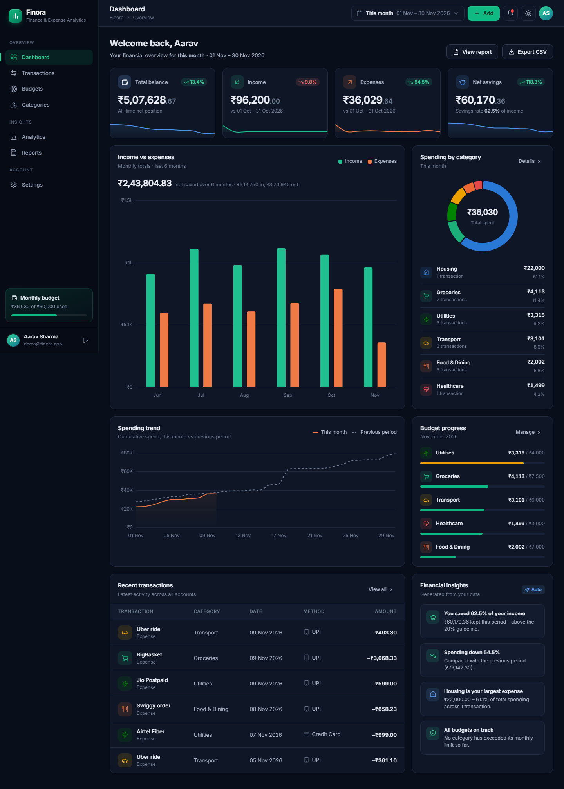 |

</details>

<details>
<summary><b>Transactions & Budgets</b></summary>
<br>

| Transactions | Budgets |
|---|---|
| 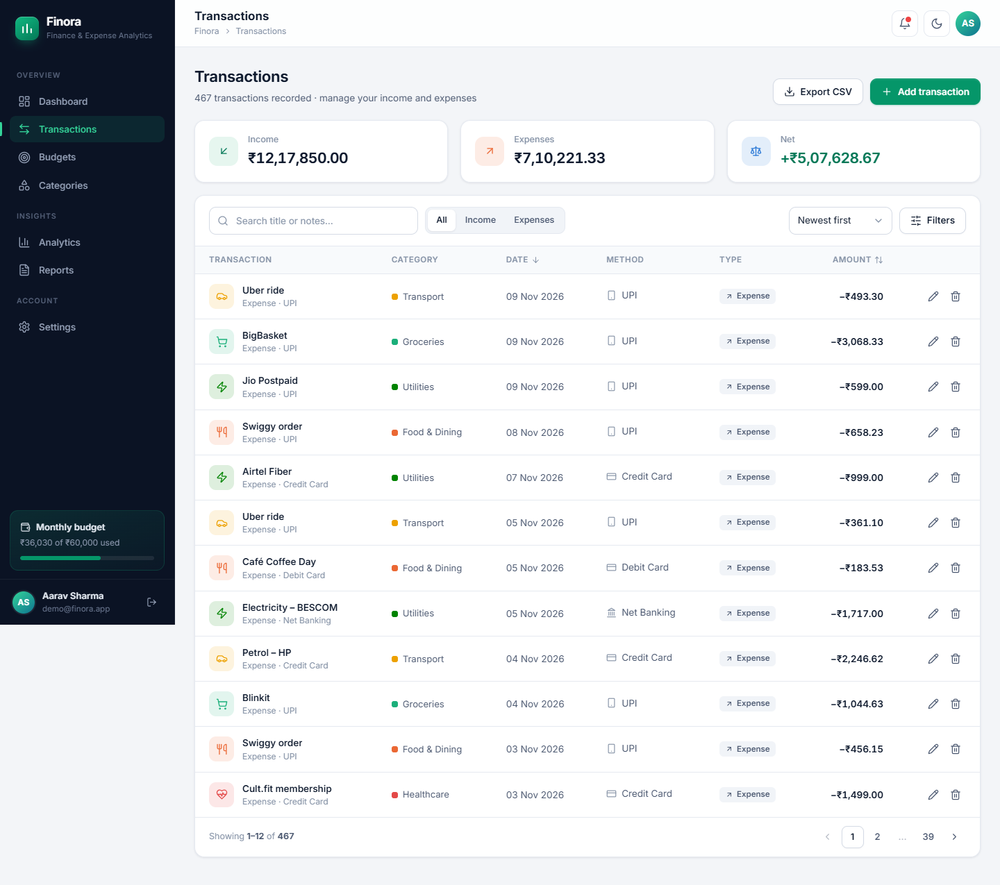 | 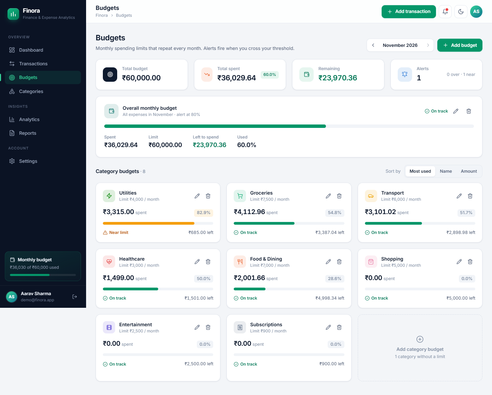 |

</details>

<details>
<summary><b>Analytics & Reports</b></summary>
<br>

| Analytics | Reports |
|---|---|
| 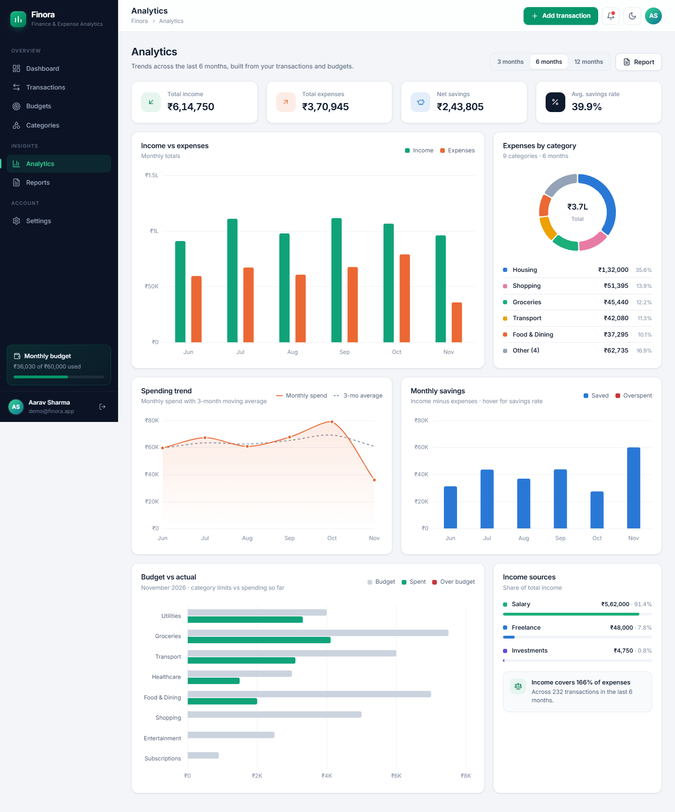 | 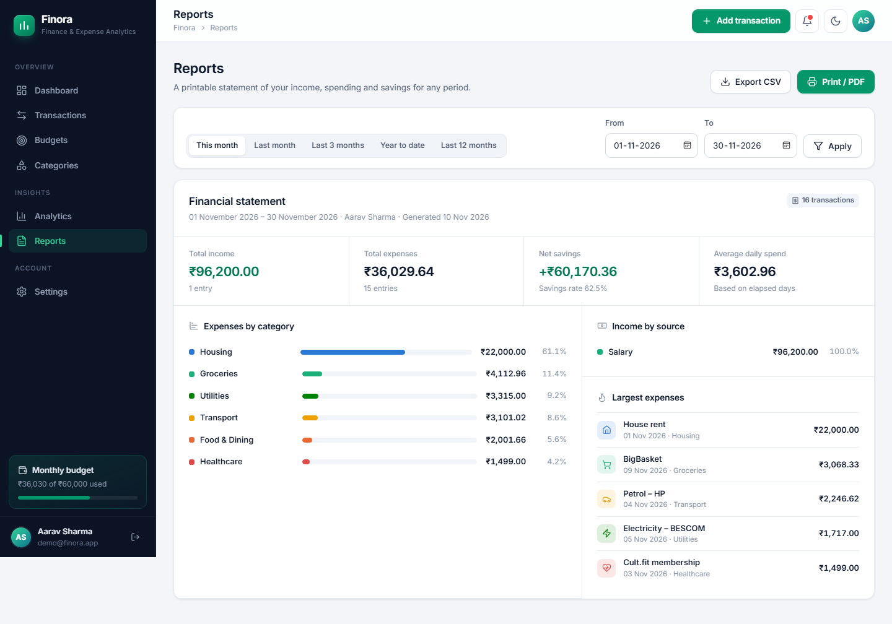 |

</details>

<details>
<summary><b>Categories, Settings & Sign in</b></summary>
<br>

| Categories | Settings |
|---|---|
| 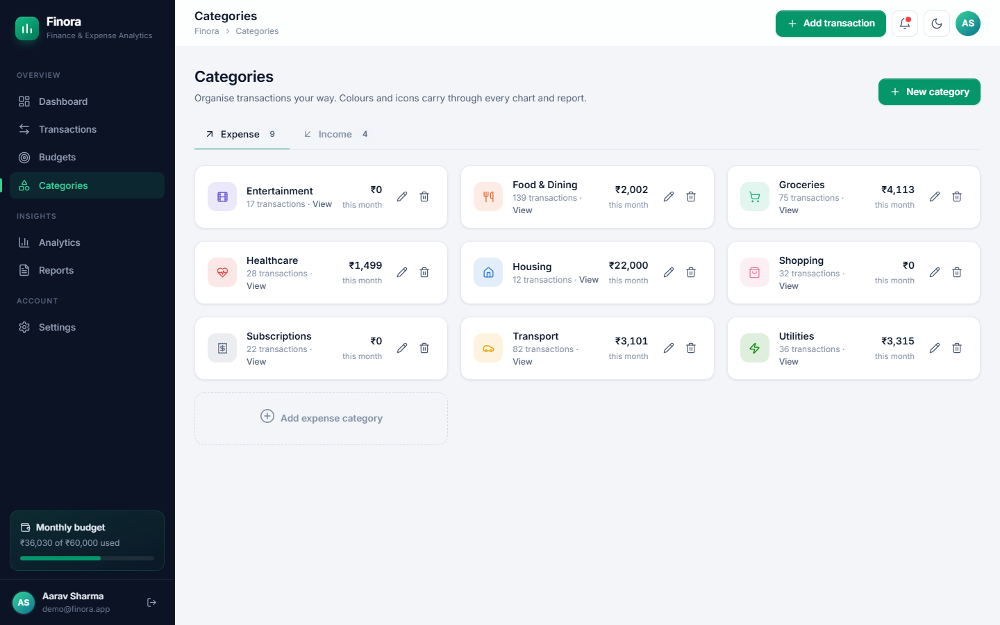 | 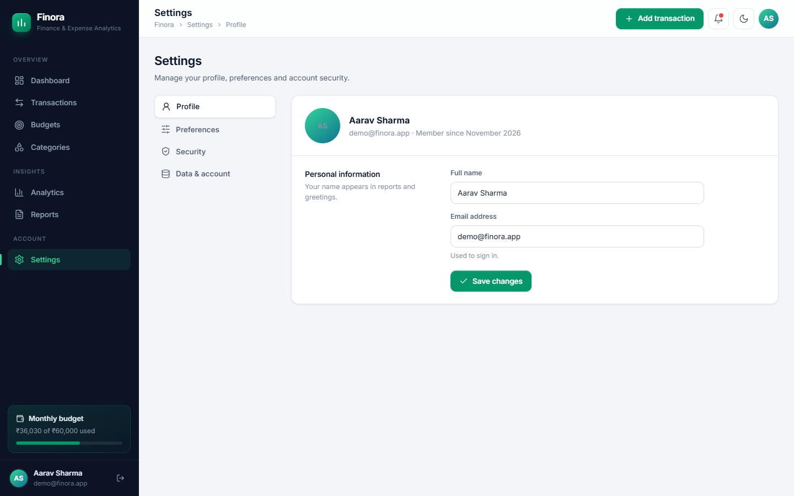 |

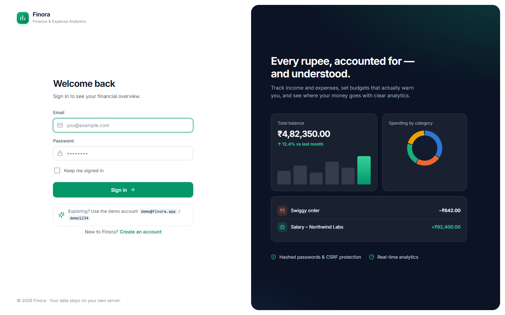

</details>

<details>
<summary><b>Responsive: tablet & mobile</b></summary>
<br>

| Tablet (768px) | Mobile (375px) | Mobile dark |
|---|---|---|
| 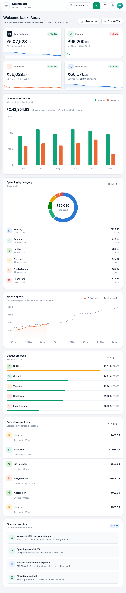 | 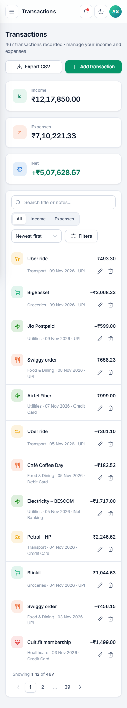 | 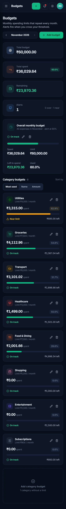 |

</details>

All 43 screenshots (every page at 1440, 1366, 768 and 375 px, plus dark mode) are in [`docs/screenshots`](docs/screenshots).

---

## 🛡 Security

| Measure | Implementation |
|---|---|
| Password storage | Werkzeug `generate_password_hash` / `check_password_hash` |
| CSRF | `CSRFProtect` on every form; `X-CSRFToken` header on the theme `fetch` call |
| Data isolation | All queries filtered by `user_id`; `owned()` returns **404** for records belonging to others |
| Input validation | Server-side checks on every form (amount range and precision, dates, enums, category ownership and type, hex colours, icon allow-list) |
| Sessions | Session cleared on login and logout; HttpOnly + SameSite=Lax cookies |
| Redirects | `next` parameter restricted to same-site relative paths |
| CSV export | Cells starting with `=`, `+`, `-`, `@` are prefixed to prevent spreadsheet formula injection |
| Headers | `X-Content-Type-Options: nosniff`, `X-Frame-Options: DENY`, `Referrer-Policy` |
| Secrets | `SECRET_KEY` from environment; `.env` and the database are git-ignored |

---

## 🔭 Future Scope

These are ideas for future work and are **not implemented yet**:

- Recurring transactions and bill reminders
- CSV / bank statement import
- Multiple accounts (bank, wallet, card) with transfers
- Real currency conversion using exchange rates
- Savings goals with progress tracking
- Database migrations (Flask-Migrate) and PostgreSQL support
- Email verification and password reset
- Docker image and CI pipeline running the test suite
- PWA / offline support with locally bundled assets

---

## 👤 Author

<div align="center">

**Rudra Bansal**

[](https://github.com/banxrudra)
[](mailto:brudra7461@gmail.com)

If you find this project useful, consider giving it a ⭐ on [GitHub](https://github.com/banxrudra/finora-personal-finance).

</div>
